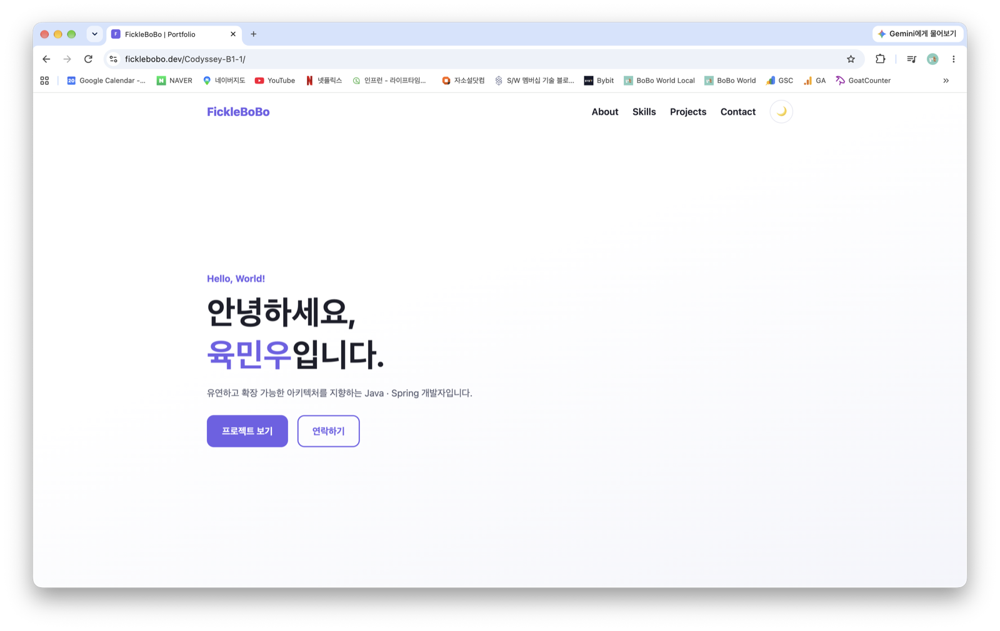
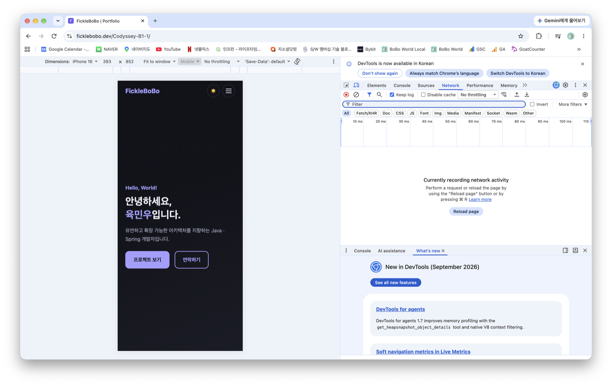
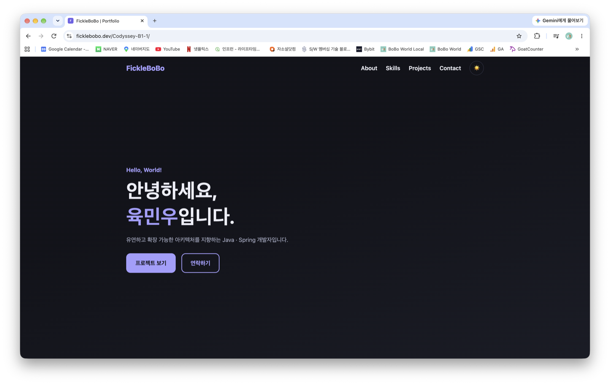

# Codyssey B1-1: 나를 소개하는 웹페이지 처음부터 만들기

## 프로젝트 개요

외부 라이브러리 없이 순수 HTML, CSS, JavaScript만으로 만든 반응형 포트폴리오 웹사이트입니다. 화면을 그리는 데서 그치지 않고 **사용자 이벤트 → 상태 변경 → 화면 업데이트** 흐름이 코드에서 드러나도록 구성했습니다. 이 흐름은 다음 미션인 React의 상태-렌더링 모델의 기초가 됩니다.

- **배포 URL**: https://ficklebobo.github.io/Codyssey-B1-1/
- **저장소**: https://github.com/FickleBoBo/Codyssey-B1-1

### 구현 범위

- **페이지 구성**: Hero, About, Skills, Projects, Contact, Footer
- **인터랙션**: 햄버거 메뉴, 부드러운 스크롤, 스크롤 탑 버튼, 스크롤에 따른 네비게이션 스타일 변경, 다크 모드(`localStorage` 유지), 스크롤 애니메이션
- **폼**: 필수값과 이메일 형식 검증, 필드 근처 에러 메시지, 제출 성공 메시지
- **API 연동**: GitHub API로 저장소 목록을 가져와 카드로 렌더링 (로딩 / 성공 / 에러 / 빈 상태)
- **배포**: GitHub Pages

보너스 과제(필터링, 타이핑 효과, 폼 실제 전송, 시스템 다크 모드 감지)는 진행하지 않았습니다.

---

## 개발 환경

| 항목        | 값                                                 |
| ----------- | -------------------------------------------------- |
| OS          | macOS 27.0.1                                       |
| 에디터      | VSCode 1.142.0 (Live Server 확장)                  |
| 브라우저    | Chrome 155.0.8059.85                               |
| 사용 기술   | HTML5, CSS3, JavaScript (ES6+)                     |
| 외부 의존성 | 없음 (라이브러리, 웹 폰트 미사용. 아이콘은 이모지) |
| 배포        | GitHub Pages (`main` 브랜치 루트)                  |

---

## 파일 구조

```
.
├── index.html          # 메인 페이지 (시맨틱 마크업)
├── css/
│   └── style.css       # CSS 변수, 다크 모드, 레이아웃, 반응형
├── js/
│   └── main.js         # 인터랙션, 상태 관리, API 연동, 폼 검증
├── images/
│   ├── profile.png     # About 프로필 이미지
│   ├── favicon.svg
│   └── screenshot-*.png  # README 스크린샷
├── .gitignore
└── README.md
```

---

## 실행 방법

VSCode에서 Live Server 확장으로 `index.html`을 엽니다. 빌드 과정은 없습니다.

---

## 스크린샷

### 데스크톱



### 모바일



### 다크 모드



---

## 기준값

값은 `js/main.js` 상단 상수로 정의했습니다.

| 동작                   | 상수                   | 값    |
| ---------------------- | ---------------------- | ----- |
| 네비게이션 배경 변경   | `NAV_SCROLL_THRESHOLD` | 60px  |
| 스크롤 탑 버튼 표시    | `TOP_BTN_THRESHOLD`    | 300px |
| 스크롤 애니메이션 진입 | `REVEAL_THRESHOLD`     | 0.2   |

반응형 브레이크포인트는 모바일 퍼스트로 `768px`(태블릿), `1024px`(데스크톱)입니다.

---

## 구조 설계

### 시맨틱 마크업

| 태그             | 사용 기준                                                    |
| ---------------- | ------------------------------------------------------------ |
| `header` / `nav` | 사이트 공통 머리글과 주요 메뉴 (`aria-label` 부여)           |
| `main`           | 페이지 고유 콘텐츠. 문서에 하나만 둠                         |
| `section`        | 제목(`h2`)을 가진 주제 단위. `aria-labelledby`로 제목과 연결 |
| `article`        | 그 자체로 독립된 콘텐츠: 자기소개 본문, Projects 저장소 카드 |
| `footer`         | 저작권과 소셜 링크                                           |

`div`는 의미 없는 레이아웃 래퍼에만 사용했습니다. 폼은 모든 입력에 `label for` ↔ `id`를 연결했고, 이미지는 내용을 설명하는 `alt`를 넣었습니다.

### Flexbox와 Grid 선택

- **네비게이션은 Flexbox**: 로고 왼쪽, 메뉴 오른쪽처럼 한 방향 정렬 문제입니다.
- **Projects 카드는 Grid**: `repeat(auto-fit, minmax(260px, 1fr))`로 행과 열을 함께 다루며, 미디어 쿼리 없이 화면 폭에 맞춰 열 수가 바뀝니다.

### CSS 변수와 다크 모드

색상, 폰트, 간격, 그림자를 `:root` 변수로 정의하고 `[data-theme="dark"]`에서 색상 변수만 재정의합니다. 컴포넌트 스타일은 변수만 참조하므로 테마를 바꿔도 컴포넌트 코드는 그대로입니다.

---

## 상태 → 렌더링 흐름

모든 인터랙션은 `상태 객체`를 바꾸고 `render*()` 함수가 DOM에 반영하는 구조입니다. 이벤트 핸들러가 DOM을 직접 건드리지 않습니다.

| 기능       | 이벤트                      | 상태                                      | 렌더 함수        |
| ---------- | --------------------------- | ----------------------------------------- | ---------------- |
| 다크 모드  | 토글 버튼 `click`           | `themeState.dark` (+ `localStorage` 저장) | `renderTheme`    |
| Projects   | 페이지 로드, 다시 시도 버튼 | `projectState.status`                     | `renderProjects` |
| Contact 폼 | `input`, `blur`, `submit`   | `formState` (`touched`, `submitted`)      | `renderForm`     |
| 네비게이션 | `click`, `scroll`           | `nav` (`menuOpen`, `scrollY`)             | `renderNav`      |

폼 에러 메시지는 따로 저장하지 않고 렌더링할 때 입력값에서 계산합니다. 상태를 한 곳(입력값)에서만 유지해 값과 에러가 어긋나지 않게 했습니다.

---

## GitHub API 연동

`https://api.github.com/users/FickleBoBo/repos`를 `fetch`와 `async/await`로 호출하고, `try/catch`로 실패를 처리합니다.

| 상태      | 조건                               | UI                                                       |
| --------- | ---------------------------------- | -------------------------------------------------------- |
| `loading` | 요청 시작                          | 스피너와 "로딩 중..."                                    |
| `success` | 응답 성공, 표시할 저장소 1개 이상  | 저장소 카드 그리드                                       |
| `error`   | 네트워크 오류, 응답 오류(403 포함) | "프로젝트를 불러올 수 없습니다." + 원인 + 다시 시도 버튼 |
| `empty`   | 응답 성공, 표시할 저장소 0개       | "표시할 프로젝트가 없습니다."                            |

- `sort=updated&per_page=100` 쿼리를 붙여 최근 수정 순으로 최대 100개를 받고, `filter`로 fork 저장소를 제외합니다.
- 인증 없이 호출하면 시간당 60회 제한이 있습니다. 초과하면 403이 오고, 이 경우 "요청 한도를 초과했습니다" 안내와 함께 에러 상태를 표시합니다.
- 저장소 이름과 설명은 외부 데이터이므로 `innerHTML`에 넣기 전에 이스케이프합니다.

---

## 검증

Chrome에서 확인했습니다. 아래 항목은 로컬 정적 서버에서 전부 확인했고, 배포 URL에서는 렌더링, API 카드, 다크 모드 유지, 스크롤 동작, 폼 에러 표시를 다시 확인했습니다.

| 항목                  | 확인 내용                                                                                                      |
| --------------------- | -------------------------------------------------------------------------------------------------------------- |
| 반응형                | 767px/768px, 1023px/1024px 경계에서 햄버거와 레이아웃 전환, 모바일 폭에서 가로 스크롤 없음                     |
| 햄버거 메뉴           | 열기/닫기 토글, 메뉴 링크 클릭 시 닫힘                                                                         |
| 스크롤                | 60px에서 네비 배경 변경, 300px에서 스크롤 탑 버튼 표시, 클릭 시 맨 위로 이동                                   |
| 다크 모드             | 토글 전환, `localStorage` 저장, 새로고침 후 유지                                                               |
| 폼                    | 빈 제출, 잘못된 이메일 형식, 정상 제출(성공 메시지, 폼 초기화)                                                 |
| API 로딩/에러/빈 상태 | `fetch`를 대체해 로딩 지연, 403, 네트워크 오류, 빈 배열, fork만 있는 경우를 재현. 에러 상태의 다시 시도로 복구 |
| 코드 스타일           | `var`, `onclick`, 인라인 `style` 없음 (`grep`으로 확인)                                                        |
